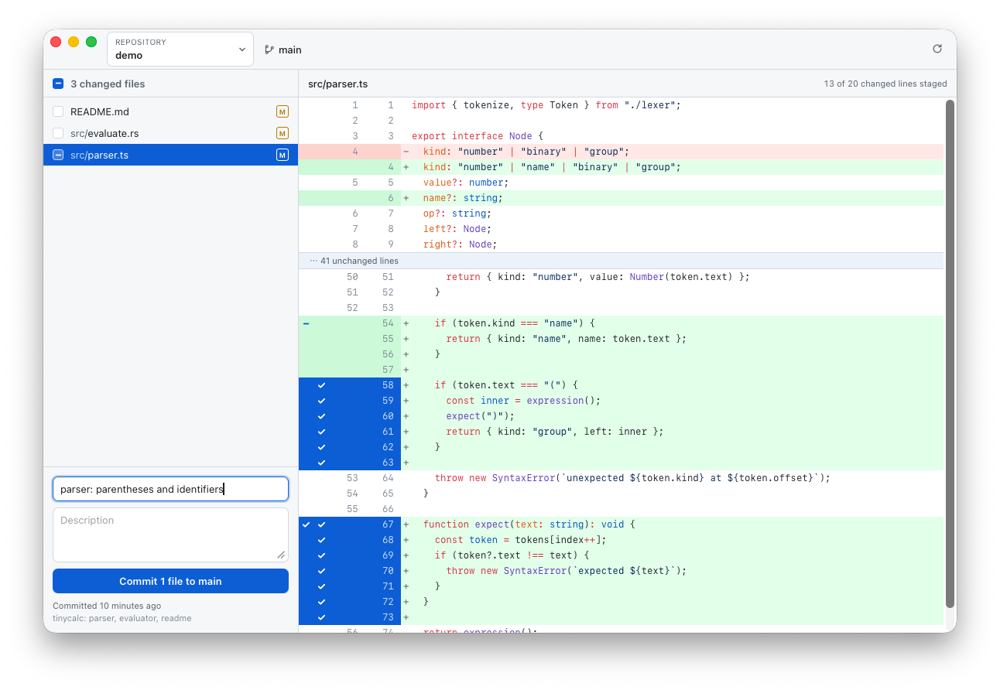
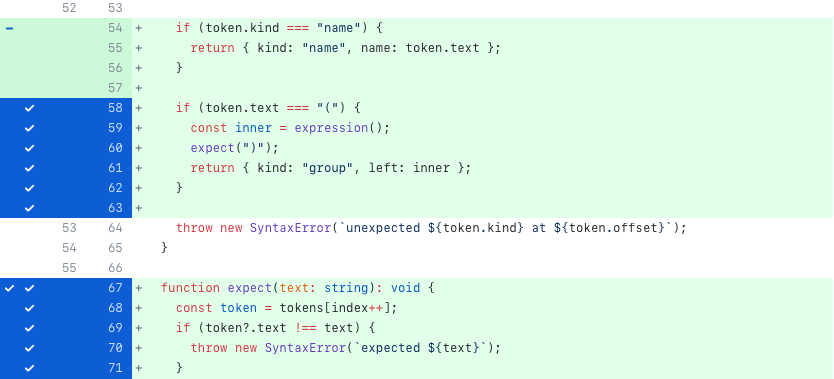
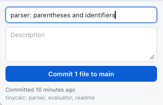

<div align="center">


# Stage

**A small desktop git GUI that drives your own `git`.**

[](https://github.com/Illizian/stage/releases)
[](https://github.com/Illizian/stage/releases)
[](LICENSE)


[Download](#install) · [Features](#what-it-does) · [How it works](#how-the-view-works) · [Build it](#building-it-yourself)

</div>

<picture>
  <source media="(prefers-color-scheme: dark)" srcset="docs/screenshots/hero-dark.png">
  
</picture>

---

There is no embedded git implementation and nothing writes to `.git` directly —
every action shells out to the same binary your terminal uses.

The point of that: when you stage a single line here, `git status` in your
terminal reports the file as both staged and unstaged (`MM`), exactly as if you
had used `git add -p`.

```console
$ git status --porcelain
MM src/parser.ts
```

## Install

Grab the `.dmg` from [Releases](https://github.com/Illizian/stage/releases),
open it, and drag Stage to Applications. Universal build — Apple Silicon and
Intel, signed and notarised.

## What it does

|  | |
| --- | --- |
| **Line-level staging** | Click a changed line, or drag across a range. Staged lines stay where they are and turn blue with a tick — they do not vanish from the view. |
| **Hunk and whole-file staging** | Toggle a file from the list, or everything at once from the header checkbox. |
| **One honest diff** | HEAD → worktree in a single pane, with a per-line checkbox saying whether that change is *currently in the index*. No separate staged and unstaged panels to reconcile, and a running `13 of 20 changed lines staged` count in the header. |
| **Folded context** | Runs of untouched lines collapse into a `41 unchanged lines` bar you can click to expand. |
| **Syntax highlighting** | Via [Shiki](https://shiki.style) — TextMate grammars, around 200 languages, and the same themes GitHub uses. |
| **Commit** | Summary and description, `⌘↵` to commit. Shows the last commit and how long ago it landed. |
| **Repository picker** | Folder picker with recents, branch name, and ahead/behind counts. |
| **Light and dark** | Follows the system appearance. |

Keyboard: `⌘O` open a repository, `⌘R` refresh, `⌘↵` commit.

That is the whole feature set. No push, pull, fetch, branching, history or
merge tooling — use the command line for those.

### Staging a line



Blue and ticked means that line is in the index right now. Everything else in
the hunk is still only in your working tree. The file shows up as `MM` in
`git status`, and `git diff --cached` shows exactly the lines you ticked.

### Committing

The button names the branch it will commit to, and stays disabled until there
is both a summary and something staged. `⌘↵` from either field does the same.



## How the view works

There is one diff, HEAD → worktree, and each changed line carries a checkbox
saying whether that change is **currently in the index**. Git will not report
that directly, so it is derived from the two diffs git *will* give us, both
taken at full context so they cover every line:

```text
  A = git diff --cached   HEAD  → index
  B = git diff            index → worktree
```

Both describe the same index blob, so walking them together keyed on index
line numbers yields a three-way alignment. Where a line sits in the three
sides says both what it is and whether it is staged:

| HEAD | index | worktree | shown as |
| --- | --- | --- | --- |
| yes | yes | yes | context |
| no | yes | yes | addition, staged (ticked) |
| no | no | yes | addition, unstaged |
| yes | no | no | deletion, staged (ticked) |
| yes | yes | no | deletion, unstaged |

Toggling a line builds a patch from whichever alignment holds it — B to stage,
A to unstage (applied with `--reverse`) — and hands it to `git apply --cached`,
which touches only the index. Because both alignments are full-context, every
generated patch is a single hunk starting at line 1, with no offset arithmetic.

Unchanged lines more than three away from any change are folded into a
"N unchanged lines" bar you can click to expand.

Both whole files are reconstructed from the rows and tokenised as complete
documents rather than line by line, so a line sitting inside a multi-line
string or comment is coloured with the context it actually has. Deleted lines
are tokenised from the HEAD side, everything else from the worktree side.
Highlighting is keyed on the file text, so staging a line — which changes the
rows but not a character of either file — does not re-highlight.

A drag takes its direction from the line it started on, so one drag either
stages or unstages, never both.

Some cases are whole-file only, and the app says so in the diff pane:

| Case | Why |
| --- | --- |
| Untracked files | git has no blob to diff against, so there is nothing to align |
| Renames | reversing a partial patch would undo the rename too |
| Binary files | no line structure |
| Diffs over 20,000 rows | truncated for responsiveness |

## Which git it uses

The login shell is asked for its `PATH` at startup (`$SHELL -l -c 'command -v
git'`), because an app launched from Finder otherwise inherits a bare `PATH` and
would silently pick Apple's git over a Homebrew one. Falls back to
`/opt/homebrew/bin/git`, `/usr/local/bin/git`, `/usr/bin/git`. Override with
the `STAGE_GIT_PATH` environment variable.

## Building it yourself

```sh
bun install
bun run tauri dev      # development
bun run tauri build    # .app + .dmg in src-tauri/target/release/bundle/
```

Open a specific repository at launch — useful for a shell alias:

```sh
open -a Stage --args /path/to/repo
# or
STAGE_OPEN=/path/to/repo /Applications/Stage.app/Contents/MacOS/Stage
```

## Tests

```sh
cd src-tauri && cargo test
```

`unified::tests` cover the three-way classification and patch rewriting in
isolation. The `e2e` module builds throwaway repositories, runs the real `git`,
and asserts on `git status --porcelain` and the actual index contents — that is
what proves the staging is genuine rather than bookkeeping inside the app.
`staging_one_line_leaves_the_others_unchecked` is the one to read first: it
asserts both that git reports `MM f.txt` and that the line stays in the view
with a tick.

Two ignored tests exist for working on the UI against a real repository:

```sh
STAGE_OPEN=/path/to/repo STAGE_FILE=some/file cargo test -- --ignored stage_one_line
STAGE_OPEN=/path/to/repo STAGE_FIXTURE=/tmp/fx.json cargo test -- --ignored dump_ui_fixture
```

## Layout

```
src-tauri/src/git.rs      process wrapper, status parsing, whole-file ops
src-tauri/src/unified.rs  three-way alignment, folding, patch synthesis
src-tauri/src/lib.rs      Tauri commands + end-to-end tests
src/App.tsx               app state and layout
src/syntax.ts             language detection and Shiki tokenising
src/components/           TopBar, FileList, DiffView, CommitBox
src/styles.css            light and dark palettes
```

## Releasing

Push a `v*` tag; a GitHub Actions workflow builds the universal app, signs and
notarises it, and attaches it to a draft release. See
[docs/RELEASING.md](docs/RELEASING.md).

## Cross-platform

Tauri builds for Windows and Linux from the same source. Nothing in the git
layer is macOS-specific apart from the login-shell `PATH` lookup, which is
harmless elsewhere. The window uses the macOS overlay title bar — the top bar
starts window drags itself via `startDragging()`, and carries 82px of left
padding to clear the traffic lights, which should be made conditional before
shipping a Windows or Linux build.

## Licence

MIT — see [LICENSE](LICENSE).
